 

  

## 👋 Hi, I'm Ansh Singh!

### Bit Summary About Me :)

AI/ML Engineer 🤖 | LLM & RAG Builder ⚡ | Data Analyst 📊 | IoT Graduate 🔌

I'm a **B.Tech. Industrial IoT graduate (CGPA 8.45, 2026)** 🎓 who likes taking models all the way to production 🚀.
As an **AI Engineer at Gumlabs** I worked on **Twik AI Voice Keyboard**, used by **400K+ people** 📱, wiring speech and NLP pipelines into the app.
At **IBM** 🏢 I automated data-cleaning and EDA pipelines (30% fewer data errors) and built dashboards that cut reporting time by 40% 📈.
I've also written an **IEEE conference paper** 📝 on physics-informed federated learning, and I'm **available now for full-time roles** ✨.

 

## 🚀 Featured Projects

<table>
  <tr>
    <td width="50%" valign="top">
      <h3>🫀 <a href="https://github.com/Martian172/cardiosense_ai">CardioSense AI</a></h3>
      
Real-time cardiac anomaly detection from ECG signals.

      <ul>
        <li>PyTorch autoencoder, <b>96% accuracy</b> on held-out data</li>
        <li>FastAPI + JWT + WebSocket live inference, React 18 UI</li>
        <li>Gemini RAG chatbot that explains the model's predictions</li>
      </ul>
      
      
      
    </td>
    <td width="50%" valign="top">
      <h3>⛓️ <a href="https://github.com/Martian172/llm-chain-forge">LLM Chain Forge</a></h3>
      
Framework for multi-step LLM pipelines with cost tracking.

      <ul>
        <li>Plug-in OpenAI and Anthropic providers, LRU/TTL caching</li>
        <li>Token and cost tracking for every call</li>
        <li>Prompt A/B testing with the Mann-Whitney U test</li>
      </ul>
      
      
      
    </td>
  </tr>
  <tr>
    <td width="50%" valign="top">
      <h3>🔎 <a href="https://companylens-ai.vercel.app">Company Research AI</a></h3>
      
Agent that crawls a company's site and writes a research profile.

      <ul>
        <li>Products, AI-found pain points and competitors, plus a PDF report</li>
        <li>OpenRouter with schema-checked output and fallback across 8 models</li>
        <li>Discord bot posts each finished report automatically</li>
      </ul>
      
      
      
    </td>
    <td width="50%" valign="top">
      <h3>🛰️ <a href="https://github.com/Martian172/mlops-sentinel">MLOps Sentinel</a></h3>
      
Monitoring and alerting toolkit for production models.

      <ul>
        <li>Data-drift detection with the KS test and PSI</li>
        <li>Slack and email alerts when a threshold is crossed</li>
        <li>Prometheus + Grafana, one-command Docker Compose setup</li>
      </ul>
      
      
      
    </td>
  </tr>
</table>

  🎮 Also check out <a href="https://anshsingh-ai.vercel.app"><b>HireMe AI</b></a>, my game-themed portfolio where you can chat with an AI twin trained on my resume.

## 💼 Experience

| Role | Company | When | Highlights |
|---|---|---|---|
| 🤖 **AI Engineer Intern** | Gumlabs Pvt. Ltd. | Sep 2025 – Jun 2026 | AI/NLP features for Twik AI Voice Keyboard (**400K+ users**) |
| 📊 **Data Analyst Intern** | IBM CSR SkillsBuild | Jun 2025 – Aug 2025 | Python/SQL pipelines (**−30% data errors**), dashboards (**−40% reporting time**) |

## 📝 Research

> **Physics-Informed Neural Networks with Federated Learning for Microgrid Management**
> *ICIC3S-2026, IIIT Una · IEEE* — ✅ Accepted
>
> Enforces Kirchhoff's laws inside the loss function so edge devices can train together without sharing raw data.
> **10x faster inference** (0.019s → 0.002s) and **50%+ faster RL convergence**.

## 🧰 Tech Stack

**🧠 Generative AI** 

**🔬 Machine Learning** 

**⚙️ Backend & MLOps** 

**📊 Data & Analytics** 

## 📈 GitHub Stats

  
  
   
  

## 🏆 Leadership

- 🎤 **Core Organiser, ICAPIE Research Conference**: coordinated speakers and paper submissions from 15+ institutions
- 🧑‍🤝‍🧑 **Class Representative, USAR (2023–2026)**: the main link between 120+ students and faculty

 

**💬 Want to work together? Ask my [AI twin](https://anshsingh-ai.vercel.app) or [send me a message](https://anshsingh-ai.vercel.app/contact/).**

